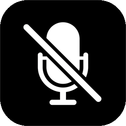
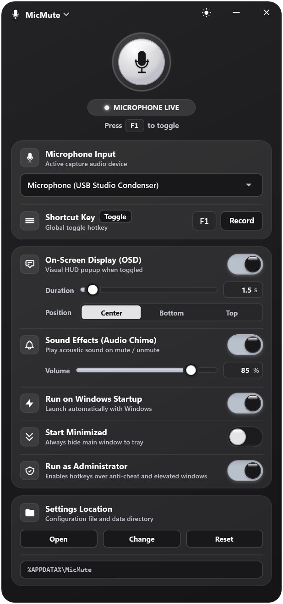
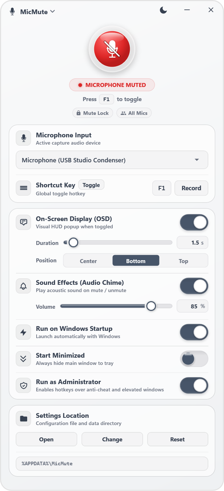
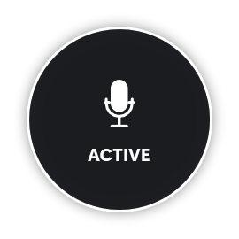
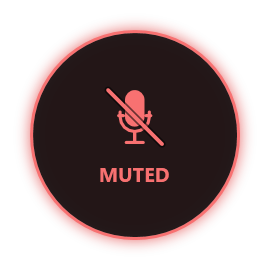
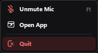
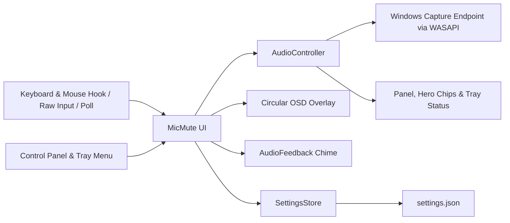

<div align="center">



# MicMute

**A fast, lightweight Windows 10 & 11 microphone mute utility with in-game global hotkeys, a minimalist circular OSD, and a liquid-glass UI.**

[-0078D6?style=for-the-badge&logo=windows11&logoColor=white)](https://github.com/youssefhazem3-dot/MicMute/releases/latest)
[](https://dotnet.microsoft.com/en-us/download/dotnet/8.0)
[](https://github.com/youssefhazem3-dot/MicMute/releases/latest)
[](https://github.com/youssefhazem3-dot/MicMute/actions/workflows/ci.yml)
[](LICENSE)

<br />

<a href="https://github.com/youssefhazem3-dot/MicMute/releases/latest">
  
</a>
&nbsp;
<a href="https://github.com/youssefhazem3-dot/MicMute/releases/latest/download/MicMute-win-x64.zip">
  
</a>
&nbsp;
<a href="https://github.com/youssefhazem3-dot/MicMute/releases/latest/download/MicMute-win-x64-standalone.zip">
  
</a>

<br />

[Download & Install](#-download--installation) · [Screenshots](#-screenshots) · [Features](#-features) · [Quick Start](#-quick-start) · [Build from Source](#-build-from-source) · [Report an Issue](https://github.com/youssefhazem3-dot/MicMute/issues)

</div>

---

MicMute toggles your Windows microphone mute state directly through **WASAPI** — it **never records, captures, or transmits audio**, has zero telemetry, and trims its working-set memory when minimized to the system tray.

## 📸 Screenshots

<div align="center">

| Dark Mode *(Microphone Live)* | Light Mode *(Microphone Muted + Active Mode Chips)* |
| :---: | :---: |
|  |  |

| Circular OSD — Active | Circular OSD — Muted | System Tray Menu (`192px`) |
| :---: | :---: | :---: |
|  |  |  |

</div>

---

## ⬇ Download & Installation

All official builds are published on the [**GitHub Releases page**](https://github.com/youssefhazem3-dot/MicMute/releases/latest) along with `SHA256SUMS.txt` for verification. Choose the build that fits your setup:

| Package | Direct Download | Size | Requirements |
| :--- | :--- | :---: | :--- |
| **Lightweight** *(Recommended)* | [**Download `MicMute-win-x64.zip`**](https://github.com/youssefhazem3-dot/MicMute/releases/latest/download/MicMute-win-x64.zip) | ~0.6 MB zip *(~1.35 MB `.exe`)* | [.NET 8 Desktop Runtime (`x64`)](https://dotnet.microsoft.com/en-us/download/dotnet/8.0) |
| **Standalone** *(Zero Prerequisites)* | [**Download `MicMute-win-x64-standalone.zip`**](https://github.com/youssefhazem3-dot/MicMute/releases/latest/download/MicMute-win-x64-standalone.zip) | ~65 MB zip *(Self-Contained)* | **None** — runs out of the box on Windows 10 / 11 `x64` |

### Installing .NET 8 Desktop Runtime *(Lightweight build only)*
If you choose the **Lightweight** build and Windows asks for the .NET Desktop Runtime, install it in one command from PowerShell / Terminal:

```powershell
winget install Microsoft.DotNet.DesktopRuntime.8
```

Or download the official **`.NET Desktop Runtime 8.0 (x64)`** installer directly from Microsoft:  
👉 **[Download .NET 8 Desktop Runtime (x64)](https://dotnet.microsoft.com/en-us/download/dotnet/8.0)**

> **Note:** Extract `MicMute.exe` from the `.zip` archive before running it. If Windows flags the downloaded file from the internet, right-click `MicMute.exe` → **Properties** → check **Unblock**, or run `.\scripts\unblock.ps1 -Target path\to\MicMute.exe`.

---

## ✨ Features

- **In-Game & Anti-Cheat Ready Hotkeys**
  - Combines a low-level keyboard hook, Raw Input, and physical key polling so shortcuts trigger reliably without blocking the key from the foreground app.
  - Supports **keyboard combinations** and **mouse buttons** (`Middle Click`, `Mouse 4`, `Mouse 5`).
  - Switch between **Toggle** mode and **Hold** mode (**Push-to-Talk / Push-to-Mute**).
  - Dedicated non-typing keys work even while holding movement keys (e.g., sprinting or crouching in-game).
  - Optional **Run as Administrator** elevates hotkey reliability over admin apps and protected games.
- **Minimalist Circular OSD**
  - Crisp, theme-aware circular HUD showing **ACTIVE** or **MUTED** (with an instant coral-red slash on frame 1).
  - Configurable duration from **`0.1s` to `30.0s`** (slider or direct keycap input with `Esc` to revert).
  - **Screen Placement selector**: choose **Center**, **Bottom** *(keeps game crosshairs clear)*, or **Top**.
- **Power-User App Menu (`MicMute ▾`)**
  - **Startup State**: choose `Keep Last`, `Always Muted`, or `Always Live` on launch.
  - **Sync All Mics**: mute and unmute every active capture microphone together.
  - **Mute Lock**: blocks Discord, games, or other apps from silently changing your mute state.
  - Active power modes appear as subtle **hero chips** (`Mute Lock`, `All Mics`) right under the main button.
  - Built-in **Check for Updates...** checks GitHub Releases automatically.
- **Acoustic Chime & Volume Control**
  - Optional mute/unmute audio feedback with a **`0%–100%`** volume slider and instant chime preview on mouse release.
- **Fast System Tray Integration**
  - **Single left-click** the tray icon to open or restore the control panel.
  - **Right-click** for a sleek `192px` dark/light menu showing dynamic **Mute Mic / Unmute Mic** status, your live shortcut hint, **Open App**, and **Quit**.
- **Privacy & Portable Mode**
  - Pure WASAPI endpoint mute toggling — never accesses or records microphone audio.
  - Stores settings in `%APPDATA%\MicMute\settings.json` by default, or switch to **Portable Mode** by placing an empty `portable.flag` file next to `MicMute.exe`.
  - Release provenance and signing details are documented in [CODE_SIGNING_POLICY.md](CODE_SIGNING_POLICY.md).

---

## 🚀 Quick Start

1. Download and extract either `MicMute-win-x64.zip` or `MicMute-win-x64-standalone.zip`, then launch **`MicMute.exe`**.
2. Click the large microphone button or press **`F1`** *(default shortcut)* to toggle mute.
3. Click **Record** under **Shortcut Key** to assign any keyboard combo or mouse button (`Middle`, `Mouse 4`, `Mouse 5`), and click **Toggle / Hold** to switch shortcut modes.
4. Click the **Sun / Moon** icon in the title bar to switch between **Dark** and **Light** themes.

### Command-Line Arguments

| Flag | Behavior |
| :--- | :--- |
| `--minimized` | Starts MicMute hidden in the system tray. |
| `--show` | Forces the control panel open on launch (overrides **Start Minimized**). |
| `--diagnostic` | Streams real-time audio and hotkey diagnostic logs to the console. |

---

## 🛠️ Build from Source

Requires the **[.NET 8 SDK](https://dotnet.microsoft.com/en-us/download/dotnet/8.0)** on Windows `x64`.

```powershell
git clone https://github.com/youssefhazem3-dot/MicMute.git
cd MicMute

# Build solution (Release)
dotnet build MicMute.sln -c Release

# Run all 112 automated unit & UI regression tests
dotnet run --project tests/MicMute.Tests/MicMute.Tests.csproj -c Release
```

Or use the included helper scripts in `scripts/` *(passing `-ExecutionPolicy Bypass` if Windows PowerShell script execution is restricted)*:

```powershell
powershell -ExecutionPolicy Bypass -File .\scripts\build.ps1
powershell -ExecutionPolicy Bypass -File .\scripts\test.ps1

# Publish Lightweight single-file build to publish/
powershell -ExecutionPolicy Bypass -File .\scripts\publish.ps1

# Publish Standalone self-contained single-file build to publish/
powershell -ExecutionPolicy Bypass -File .\scripts\publish.ps1 -SelfContained
```

---

## 🏗️ Architecture & Project Layout



```text
MicMute/
├── .github/workflows/        # Automated CI (build + 112 tests) & GitHub Release packaging
├── docs/screenshots/         # README logo and high-DPI UI showcase screenshots
├── scripts/                  # Build, test, publish, unblock, and diagnostic runner scripts
├── src/MicMute/
│   ├── Assets/               # App icon (app.ico), UAC manifest, and mute/unmute WAV chimes
│   ├── Audio/                # WASAPI AudioController, device tracking, chime playback, STA queue
│   ├── Hotkeys/              # 3-engine HotkeyManager, HotkeyState, RawKeyboardPacket
│   ├── Platform/             # StartupManager, AdminManager, single-instance mutex, diagnostics
│   ├── Settings/             # AppSettings, JSON codec, debounced SettingsStore & portable mode
│   ├── UI/                   # App, MainWindow, OsdWindow (WPF XAML + C#), UiBehavior
│   └── MicMute.csproj
├── tests/MicMute.Tests/      # 112 automated regression tests (audio, hotkeys, settings, UI)
├── LICENSE                   # MIT License
└── MicMute.sln
```

---

## 🤝 Contributing

Bug reports, feature ideas, and pull requests are welcome! Please include your Windows version and clear reproduction steps, and make sure all regression tests pass before submitting:

```powershell
dotnet run --project tests/MicMute.Tests/MicMute.Tests.csproj -c Release
```

## 📄 License

MicMute is licensed under the [MIT License](LICENSE).
